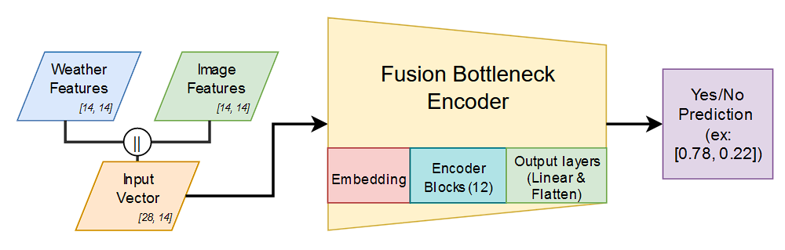

# Sentinel-Fusion

PyTorch implementation, training code and checkpoint of the fusion model described in the paper "Fusion of Satellite Images and Weather data with Transformer Networks for Downy Mildew Detection".

## Abstract
---
Crop diseases significantly affect the quantity and quality of agricultural production. In a context where the goal of precision agriculture is to minimize or even avoid the use of pesticides, weather and remote sensing data with deep learning can play a pivotal role in detecting crop diseases, allowing localized treatment of crops. However, combining heterogeneous data such as weather and images remains a hot topic and challenging task. Recent developments in transformer architectures have shown the possibility of fusion of data from different domains, for instance text-image. The current trend is to custom only one transformer to create a multimodal fusion model. Conversely, we propose a new approach to realize data fusion using three transformers. In this paper, we first solved the missing satellite images problem, by interpolating them with a ConvLSTM model. Then, proposed a multimodal fusion architecture that jointly learns to process visual and weather information. The architecture is built from three main components, a Vision Transformer and two transformer-encoders, allowing to fuse both image and weather modalities. The results of the proposed method are promising achieving 97\% overall accuracy.

## Repository details

- The `checkpoints\` contains a checkpoint for the best epoch of the model, giving the best results.
- The `dataset\` folder contains the annotated dataset and its implementation using Pytorch
- The file `SentinelLab.ipynb` contains all that is necessary to train the model and experiment with it

